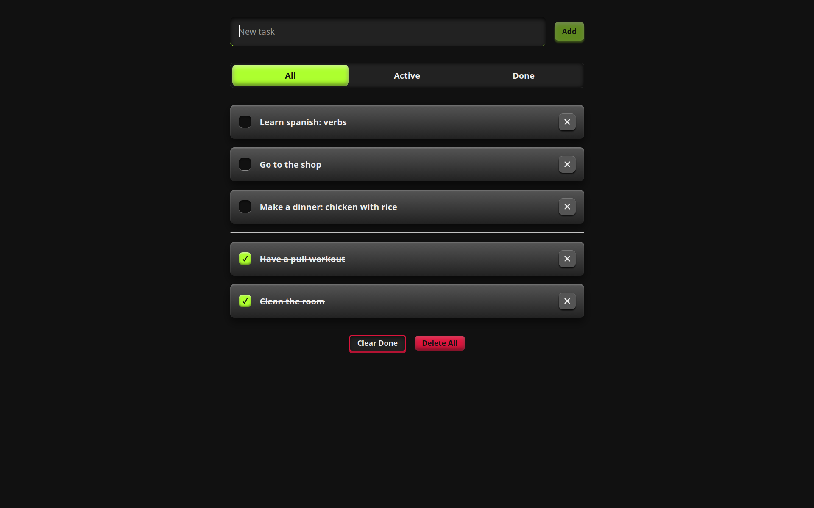

# Todo App

A simple todo app where you can add tasks, mark them as done, and filter them by status. Tasks are saved in the browser's `localStorage`.

**[Live demo](https://xopsreyli.github.io/todo/)**



## Tech Stack

- [React](https://react.dev/)
- [Vitest](https://vitest.dev/) and [React Testing Library](https://testing-library.com/docs/react-testing-library/intro/) for tests
- [JSDoc](https://jsdoc.app/) for documentation

## Getting Started

Install dependencies first:

```bash
npm install
```

Then use the following commands:

| Purpose | Command |
| --- | --- |
| Start development | `npm run dev` |
| Start production (build) | `npm run build` |
| Run tests | `npm run coverage` |
| Run docs | `npm run docs` |